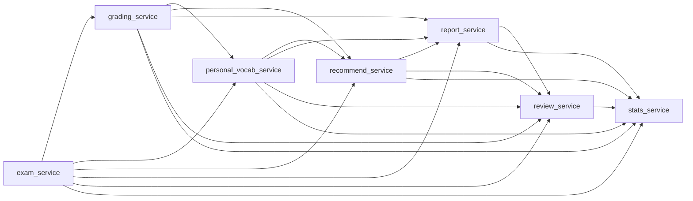

# Dependencies — 系统间依赖关系

> generated_by: nexus-mapper v2
> verified_at: 2026-07-16
> provenance: file-tree + git-stats + manual inspection

## 依赖架构图

```mermaid
graph TD
    subgraph "用户交互层"
        CLI[CLI 入口<br/>cli.py]
    end

    subgraph "命令层"
        VOCAB_C[vocab 命令]
        STATS_C[stats 命令]
        PLAN_C[plan 命令]
        WRITE_C[write 命令]
        SPEAK_C[speak 命令]
        LISTEN_C[listen 命令]
        GRADE_C[grade 命令]
        EXAM_C[exam 命令]
        EMAIL_C[email 命令]
        REPORT_C[report 命令]
        DEPLOY_C[deploy 命令]
        FEISHU_C[feishu 命令]
        RECOMMEND_C[recommend 命令]
        COURSE_C[course 命令]
    end

    subgraph "服务层"
        VOCAB_S[VocabService]
        REVIEW_S[ReviewService]
        STATS_S[StatsService]
        PLAN_S[PlanService]
        WRITE_S[WritingService]
        SPEAK_S[SpeakingService]
        LISTEN_S[ListeningService]
        GRADE_S[GradingService]
        EXAM_S[ExamService]
        EMAIL_S[EmailService]
        REPORT_S[ReportService]
        DEPLOY_S[DeployService]
        FEISHU_S[FeishuService]
        RECOMMEND_S[RecommendService]
        PERSONAL_VOCAB_S[PersonalVocabService]
        SYNC_S[SyncService]
        COURSE_S[CourseService]
    end

    subgraph "数据层"
        MODELS[数据模型<br/>models.py]
        REPO[Repository]
        SQLITE[SQLite Repo]
    end

    subgraph "内置数据"
        VOCAB_JSON[vocab JSON]
        RESOURCE_JSON[资源 JSON]
    end

    CLI --> VOCAB_C
    CLI --> STATS_C
    CLI --> PLAN_C
    CLI --> WRITE_C
    CLI --> SPEAK_C
    CLI --> LISTEN_C
    CLI --> GRADE_C
    CLI --> EXAM_C
    CLI --> EMAIL_C
    CLI --> REPORT_C
    CLI --> DEPLOY_C
    CLI --> FEISHU_C
    CLI --> RECOMMEND_C
    CLI --> COURSE_C

    VOCAB_C --> VOCAB_S
    STATS_C --> STATS_S
    PLAN_C --> PLAN_S
    WRITE_C --> WRITE_S
    SPEAK_C --> SPEAK_S
    LISTEN_C --> LISTEN_S
    GRADE_C --> GRADE_S
    EXAM_C --> EXAM_S
    EMAIL_C --> EMAIL_S
    REPORT_C --> REPORT_S
    DEPLOY_C --> DEPLOY_S
    FEISHU_C --> FEISHU_S
    RECOMMEND_C --> RECOMMEND_S
    COURSE_C --> COURSE_S

    VOCAB_S --> MODELS
    REVIEW_S --> MODELS
    STATS_S --> MODELS
    PLAN_S --> MODELS
    PERSONAL_VOCAB_S --> MODELS
    EXAM_S --> MODELS
    GRADE_S --> MODELS
    REPORT_S --> MODELS
    RECOMMEND_S --> MODELS

    VOCAB_S --> REPO
    REVIEW_S --> REPO
    STATS_S --> REPO
    PERSONAL_VOCAB_S --> REPO
    EXAM_S --> REPO

    REPO --> SQLITE
    SQLITE --> VOCAB_JSON

    VOCAB_S --> VOCAB_JSON
    WRITE_S --> RESOURCE_JSON
    SPEAK_S --> RESOURCE_JSON
    LISTEN_S --> RESOURCE_JSON
```



## 核心依赖关系

### 依赖方向（自上而下）

| 依赖者 | 被依赖者 | 类型 | 说明 |
|--------|----------|------|------|
| CLI 入口 | 命令层 | contains | cli.py 注册所有命令 |
| 命令层 | 服务层 | imports | 命令调用服务 |
| 服务层 | 数据模型 | imports | 服务使用 Pydantic 模型 |
| 服务层 | Repository | imports | 服务调用仓库接口 |
| Repository | SQLite | implements | 仓库接口的 SQLite 实现 |

### 强耦合服务组（Git 热点推断）



**耦合特征**: 所有服务两两之间 `coupling_score=1.0`，表明这些服务在历史变更中频繁共同修改。

## 依赖注入模式

项目使用**构造函数依赖注入**：
- 服务层通过构造函数接收 Repository 实例
- 命令层创建服务实例并调用

```python
# 命令层典型调用
svc = ReviewService()  # 服务实例化
due = svc.get_due_words(limit=count)

# 服务层使用 Repository
class VocabService:
    def __init__(self):
        self._repo = get_default_repository()
```

## 外部依赖

| 包 | 用途 | 来源 |
|----|------|------|
| click | CLI 框架 | pyproject.toml |
| rich | 终端美化 | pyproject.toml |
| pydantic | 数据验证 | pyproject.toml |
| jinja2 | 模板引擎 | pyproject.toml |
| openai | AI 集成 | pyproject.toml |
| anthropic | AI 集成（可选） | pyproject.toml |

## 证据缺口

- AST 不可用，import 关系来自人工推断和文件结构分析
- 实际依赖关系需要运行 AST 提取器验证
