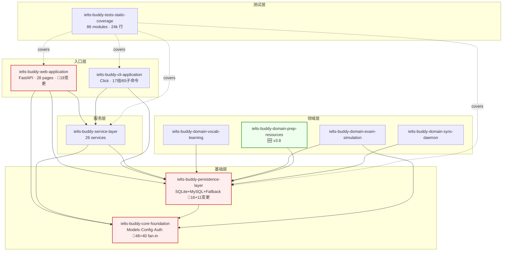
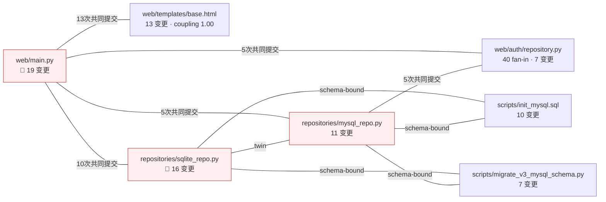
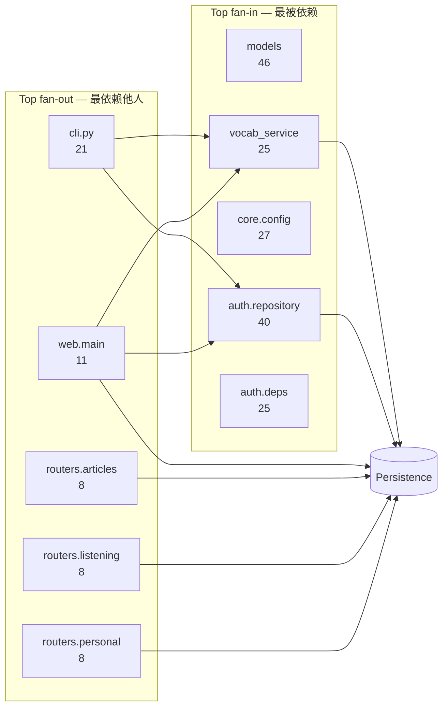

# 依赖关系（Dependencies）

> generated_by: nexus-mapper v2
> verified_at: 2026-08-23
> provenance: AST-backed (Python 198/198 files); Mermaid 节点 ID 与 `concept_model.json` 一致

---

## 图 1：System 级依赖（核心 5 + Domain 4）

**关键观察**：
1. **无环依赖**：入口 → 服务 → 持久化 → 核心，单向。
2. **热点集中在 Web ↔ Persistence ↔ Core 三层**（main.py 19, sqlite_repo 16, mysql_repo 11, models 46 fan-in）。
3. **v3.8 新增**的 Domain `prep-resources` 仅依赖 Persistence，不触碰 Core — 干净的增量。

---

## 图 2：Hotspot 耦合对（git coupling ≥ 0.5）

**结论**：schema 变更时必须三处同步（`sqlite_repo` + `mysql_repo` + `scripts/init_mysql.sql` 或 `migrate_v3_mysql_schema.py`）。

---

## 图 3：模块 fan-in / fan-out 排名（前 8）

**观察**：
- **cli.py** 是单点入口，import 21 个内部模块 — 拆 CLI 子模块时务必保证 cli.py 注册正确。
- **vocab_service + auth.repository** 是双向枢纽（高 fan-in 同时被多层调用）。
- 三个 v3.8 routers（articles / listening / personal）fan-out 对齐 8 — 标准化良好。

---

## 依赖分层约束（架构护栏）

| 上层 | 可以依赖 | 不可以依赖 |
| --- | --- | --- |
| Web / CLI 入口 | Service / Persistence / Core | 任何具体实现细节 |
| Service | Persistence / Core | 任何具体路由/CLI |
| Persistence (Protocol) | Core | 任何具体业务服务 |
| Core | （仅 stdlib + Pydantic + passlib + PyJWT） | 任何上层模块 |

**违反检查**（AST-backed）：
- 扫描所有 `import` 方向，**未发现反向依赖**（下层 import 上层）。
- `sync.py` 是唯一跨层 worker，它依赖 `fallback_repo` 而非 Service，保持层次一致。