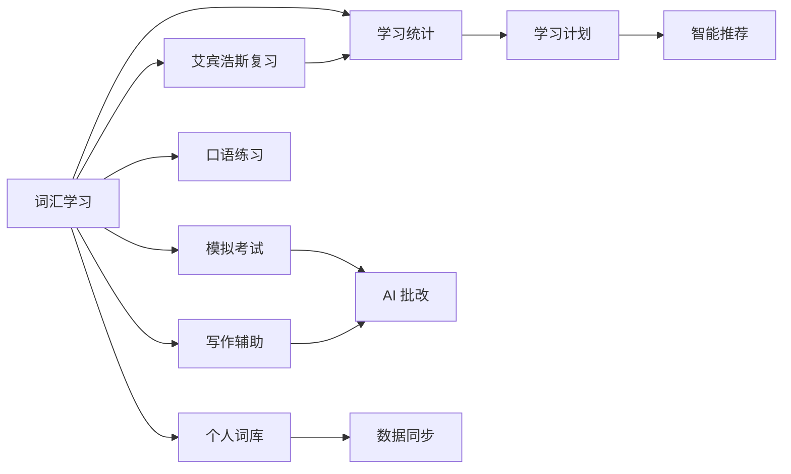

# Domains — 核心领域概念说明

> generated_by: nexus-mapper v2
> verified_at: 2026-07-16
> provenance: file-tree + manual inspection

## 核心领域概念

### 1. 词汇学习领域 (Vocabulary Learning)

**概念层级**:
- **Word**: 单词实体，包含音标、释义、例句、搭配、同义词
- **Band**: 雅思难度等级 (5-9)，表示单词难度
- **Topic**: 主题分类，如 education、environment
- **LearningRecord**: 学习记录，跟踪记忆等级和复习时间

**关键规则**:
- 词库分为精选词库 (526词) 和大词库 (4485词)
- 记忆等级 0-6，表示艾宾浩斯遗忘曲线位置
- 复习间隔：1天 → 2天 → 4天 → 7天 → 15天 → 30天

### 2. 艾宾浩斯复习领域 (Spaced Repetition)

**概念层级**:
- **memory_level**: 记忆等级，0=新词，6=长期记忆
- **next_review**: 下次复习日期
- **due_words**: 到期需复习的单词

**复习算法**:
- 答对 → 等级+1，下次复习时间延长
- 答错 → 等级重置为0，重新开始周期

### 3. 写作辅助领域 (Writing Assistance)

**概念层级**:
- **Topic**: 写作话题（technology、education、environment 等）
- **Template**: 句型模板（introduction、body、conclusion）
- **Synonym**: 同义替换词
- **GradeResult**: AI 批改结果

**评分维度**:
- Task Response: 任务回应
- Coherence & Cohesion: 连贯与衔接
- Lexical Resource: 词汇资源
- Grammatical Range & Accuracy: 语法范围与准确性

### 4. 口语练习领域 (Speaking Practice)

**概念层级**:
- **Part**: 口语考试部分 (1/2/3)
- **Topic**: 口语话题
- **Keywords**: 话题关键词汇

**Part 分区**:
- Part 1: 日常话题问答 (4-5分钟)
- Part 2: 卡片陈述 (1分钟准备，2分钟陈述)
- Part 3: 深入讨论 (4-5分钟)

### 5. 模拟考试领域 (Exam Simulation)

**概念层级**:
- **ExamSession**: 考试会话
- **ExamQuestion**: 考试题目
- **ExamReport**: 考试报告
- **TestMode**: 测验模式 (spelling/meaning/choice/context)

**测验模式**:
- en2zh: 英译中
- zh2en: 中译英
- mix: 混合模式

### 6. 学习统计领域 (Learning Statistics)

**概念层级**:
- **DailySummary**: 每日学习摘要
- **StudyPlan**: 学习计划
- **Streak**: 连续学习天数

**统计指标**:
- new_words: 今日新学单词数
- reviewed_words: 今日复习单词数
- test_accuracy: 测验正确率
- study_minutes: 学习时长

### 7. 个人词库领域 (Personal Vocabulary)

**概念层级**:
- **PersonalWord**: 个人词库单词
- **VocabCategory**: 词库分类
- **Source**: 来源 (manual/quiz_mistake/grading/import)

**特殊分类**:
- mistakes: 错题本
- starred: 收藏
- difficult: 难点

### 8. 知识卡片领域 (Knowledge Cards)

**概念层级**:
- **Course**: 课程
- **Content**: 课程内容
- **SentenceCard**: 句子知识卡片

**卡片格式**:
- 中文句子 + 关键词提取
- 英文翻译
- 知识点标注

### 9. 数据同步领域 (Data Sync)

**概念层级**:
- **FeishuBitable**: 飞书多维表格
- **SyncRecord**: 同步记录

**同步方向**:
- 本地 → 飞书
- 飞书 → 本地
- 双向同步

## 领域间关系

